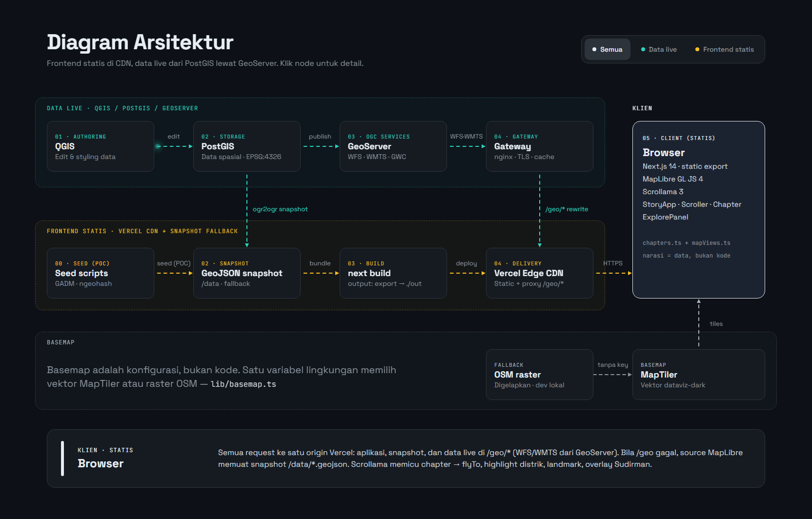
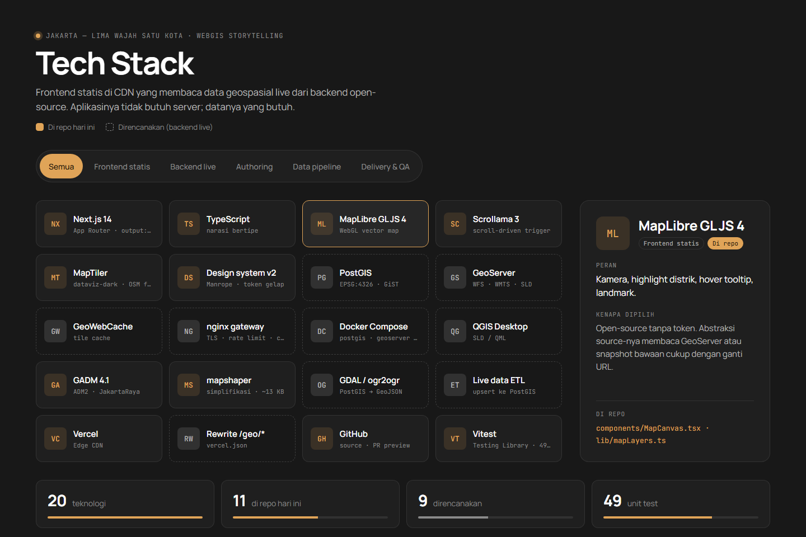

# Jakarta — Lima Wajah Satu Kota

A scroll-driven **WebGIS storytelling** proof-of-concept that walks the viewer
through the five municipalities (kota administrasi) of DKI Jakarta, then opens
into a photo gallery and a freely explorable map. Built for the Catalyze "WebGIS Development" case
study — a modern reconstruction of the digital-storytelling approach seen on
[lancastersound.wwf.ca](https://lancastersound.wwf.ca).

- **Live demo:** _<add Vercel URL after deploy>_
- **Full design doc:** [`docs/architecture.md`](docs/architecture.md) — end-to-end architecture, with diagrams.

The five chapters:

| District | Theme | Highlights |
|----------|-------|-----------|
| Jakarta Pusat | Business center (+ Sudirman congestion overlay) | Sudirman, SCBD |
| Jakarta Barat | Education & culinary | Trisakti, Untar, Ciputra, Tanjung Duren |
| Jakarta Selatan | Pop culture & entertainment | Blok M, Kemang |
| Jakarta Utara | Trade & Chinatown | PIK, Glodok |
| Jakarta Timur | Manufacturing industry | Pulogadung |

## Quick start

```bash
npm install
cp .env.example .env.local   # then paste your MapTiler key (optional, see "Basemap")
npm run data:districts    # build district boundaries from GADM (downloads once, cached)
npm run data:congestion   # build Sudirman congestion geohash cells
npm run dev               # http://localhost:3000
```

```bash
npm test          # unit tests (Vitest)
npm run build     # static export to ./out
```

The generated data (`public/data/*.geojson`) and district photos
(`public/images/photos/`) are committed, so `npm run dev` works without the data steps; rerun them only to
regenerate.

## System architecture

[](docs/design/architecture.html)

_Interactive version (animated data flow, live/static mode toggle, click a node for details):
[`docs/design/architecture.html`](docs/design/architecture.html) — open it locally in a browser._

**Static frontend, live geospatial backend.** The app is a **Next.js static export** on
the Vercel CDN — no app server, now or in production. The *data* is live: authored in
**QGIS**, stored in **PostGIS**, and served by **GeoServer** as OGC services
(**WFS / WMTS**), which the static app fetches from the browser at `/geo/*` on its own
origin — a Vercel rewrite forwards those requests to the gateway, so there is one domain
and no CORS. At build time a
**GeoJSON snapshot is exported from PostGIS** and bundled as the fallback, so the map
still works when GeoServer is down and the fallback never drifts from the live data.

This repository runs that frontend in **snapshot-only mode**: the backend is not stood
up yet, so the snapshot is seeded by build scripts from GADM and sample data.

The app behaves identically in both modes: a single full-viewport MapLibre map
sits sticky behind scrolling narrative panels; **Scrollama** fires a chapter change as
each panel enters view, flying the camera to that district, highlighting its boundary
(dimming the others), revealing its landmarks, and — for Jakarta Pusat — showing the
Sudirman congestion overlay. After the last chapter an **explore mode** unlocks free
pan/zoom with layer toggles. A persistent **three-mode nav** (Cerita · Galeri · Jelajahi)
also opens a **photo gallery** (grid + lightbox) and the explore map at any time.

The narrative is **data, not code**: `lib/chapters.ts` + `lib/mapViews.ts` declare
what each chapter says, which photos it shows, and where the camera goes. Components
are generic.

```
App (always):   next build ─▶ Vercel Edge CDN ─▶ browser            (HTML + JS)
Live data:      QGIS ─▶ PostGIS ─▶ GeoServer (WFS/WMTS) ─▶ gateway ─▶ Vercel /geo/* rewrite ─▶ browser
Fallback data:  PostGIS ─▶ ogr2ogr snapshot ─▶ /data/*.geojson (bundled at build)
                (this repo: seeded by scripts/ from GADM until PostGIS exists)
Basemap:        MapTiler (OSM raster fallback) ─▶ browser
```

The MapLibre `source` abstraction means a layer reads GeoServer or the bundled
`/data/*.geojson` with only a URL change, so the live backend can be stood up without
touching app code. Full topology, request flow, security, and deployment:
[`docs/architecture.md`](docs/architecture.md) §2 and §6.

## Basemap

The basemap is **configuration, not code** (`lib/basemap.ts`):

| `NEXT_PUBLIC_MAPTILER_KEY` | Basemap | Use |
|---|---|---|
| set | MapTiler vector style (`dataviz-dark` by default, override with `NEXT_PUBLIC_MAPTILER_STYLE`) | production / Vercel |
| empty | OpenStreetMap standard raster tiles, darkened | local dev, previews |

Story layers are inserted beneath the vector style's first label layer, so street and
place names stay readable over the coloured districts.

Why not OSM tiles in production: the [OSMF Tile Usage Policy](https://operations.osmfoundation.org/policies/tiles/)
allows light, attributed, browser-originated use, but it is best-effort with no SLA and
access can be withdrawn without notice. A keyed provider (domain-restricted key) gives
an SLA; the zero-server alternative is self-hosted **PMTiles** on the CDN (§6 of the
architecture doc).

**On Vercel:** Project → Settings → Environment Variables → add
`NEXT_PUBLIC_MAPTILER_KEY`, then redeploy (`NEXT_PUBLIC_*` values are inlined at build
time). In MapTiler Cloud, restrict the key to your Vercel domain(s).

## Data strategy

- **District boundaries:** [GADM 4.1](https://gadm.org) Indonesia ADM2, filtered to
  the five Jakarta kota (`NAME_1 = "JakartaRaya"`), coordinates rounded to ~1 m and
  committed as `public/data/jakarta-districts.geojson` (~13 KB). Built by
  `scripts/build-districts.mjs`.
  - **License note:** GADM restricts redistribution/commercial use, so only a
    simplified derivative is shipped, for this non-commercial assessment. For a
    public or commercial build, swap in [geoBoundaries](https://www.geoboundaries.org)
    (CC BY) or BPS / Jakarta Satu data — a one-file change in the build script.
- **Landmarks:** hand-authored `public/data/landmarks.geojson` (points per district).
- **Sudirman congestion:** `scripts/build-congestion.mjs` samples the Jalan Sudirman
  centerline, encodes each sample to a **geohash** (precision 7, ~150 m) with
  `ngeohash`, and emits one red (`status: "macet"`) cell polygon each. Static sample
  data; a live traffic feed would recolor these by real-time speed.
- **CRS:** WGS84 (EPSG:4326) in storage, Web Mercator at render time. Jakarta is
  equatorial, so the Arctic polar-stereographic projection the reference site needed
  (EPSG:5937) is deliberately **not** used here.

## Estimated timeline

A dated six-day build, Tue 3 Nov → Sun 8 Nov 2026 (full schedule with a Gantt chart
in [`docs/architecture.md`](docs/architecture.md) §13):

| Day | Focus |
|-----|-------|
| Tue 3 Nov | Scaffold + data pipeline (GADM, landmarks, congestion) |
| Wed 4 Nov | Chapter/camera model + MapCanvas (map, highlight, camera) |
| Thu 5 Nov | Hover + congestion + Scroller/Chapter UI |
| Fri 6 Nov | Explore mode + assembly + styling |
| Sat 7 Nov | Images + README + first Vercel deploy |
| Sun 8 Nov | QA (mobile, reduced-motion, data-failure) + submit |

Production build-out (real data pipeline + CMS, live traffic feed, multi-language,
QA, analytics): ~3–4 weeks.

## Features

- Linear scrollytelling with choreographed, pitched camera moves between districts;
  camera padding keeps the subject clear of the chapter card (desktop and mobile)
- Chapter cards with district photos (two side by side where a district has two faces)
- Chapter-dot navigator, per-district accent colours, glowing active boundary
- Active-district highlight (others dimmed) + **hover-to-highlight** with name tooltip
- Landmark markers per district, coloured by district
- **Sudirman traffic-congestion overlay** (geohash cells, red = *macet*, pulsing)
- **Explore mode** after the story: free pan/zoom + layer toggles
- **Gallery mode**: grid of all district photos with a lightbox (prev/next/close, keyboard)
- Persistent **three-mode nav** (Cerita · Galeri · Jelajahi) to switch modes anytime
- Respects `prefers-reduced-motion` (instant camera instead of fly)
- Trilingual-ready content model (currently Bahasa Indonesia)
- Static frontend, Vercel-ready, designed to read live PostGIS/GeoServer data; 70 unit tests

## Deploying to Vercel

1. Push this repo to GitHub.
2. Import it in Vercel — the Next.js preset auto-detects `output: "export"` and
   serves the static build; no extra config needed.
3. Invite `catalyzecomms` to the GitHub repo and share the repo + Vercel links.

## Reverse-engineering note

The reference, `lancastersound.wwf.ca`, is a ~2016 RequireJS SPA using **Leaflet
0.7.7 + Proj4Leaflet** on a custom Arctic projection (EPSG:5937), a **Mapbox classic
raster** basemap, and **static TopoJSON/GeoJSON** data (with an optional ArcGIS REST
path), driven by declarative JSON config across three modes — scripted *story*,
*gallery*, and free-explore *layers*. This project keeps its best ideas (config-driven
narrative, named camera views, a static-delivery fallback, story→explore arc) and
modernizes the stack (MapLibre + Next.js + Scrollama over a PostGIS + GeoServer backend),
uses real DOM text instead of pre-rendered PNG scenes, and drops the custom projection
because Jakarta is equatorial.

## Tech stack

[](docs/design/tech-stack.html)

_Interactive version (layer filter, click a card for its role and rationale):
[`docs/design/tech-stack.html`](docs/design/tech-stack.html). Full table with versions,
status and config switches: [`docs/tech-stack.md`](docs/tech-stack.md)._

**Frontend (static, in repo):** Next.js 14 (static export) · TypeScript · MapLibre GL JS 4 ·
Scrollama 3 · MapTiler · Vitest + Testing Library · Vercel.
**Live data backend (designed, not stood up yet):** PostGIS · GeoServer (WFS/WMTS +
GeoWebCache) · nginx gateway behind a Vercel `/geo/*` rewrite · Docker Compose — see [`docs/architecture.md`](docs/architecture.md) §6.
**Authoring:** QGIS Desktop (edits PostGIS, publishes styles to GeoServer).
**Data tooling:** GADM 4.1 · mapshaper · ngeohash (in repo) · GDAL `ogr2ogr` for the
PostGIS → GeoJSON snapshot (live mode).

## Project structure

```
app/            Next.js App Router (layout, page, global CSS)
components/      MapCanvas, Scroller, Chapter, ChapterDots, StoryApp,
                 ModeNav, ExplorePanel, GalleryGrid, Lightbox
lib/            chapters, mapViews, mapLayers, basemap, useScrollChapter
scripts/        build-districts / build-congestion / build-images
public/data/     districts, landmarks, congestion GeoJSON
public/images/   district photos in photos/ (+ CREDITS.md)
tests/           Vitest suites
docs/            architecture.md + implementation plan
```

## Credits & license

- Boundaries © GADM 4.1 (non-commercial; see data-strategy note above).
- Basemap © MapTiler © OpenStreetMap contributors (fallback: © OpenStreetMap contributors).
- District photos — sources and licenses in
  [`public/images/CREDITS.md`](public/images/CREDITS.md).
