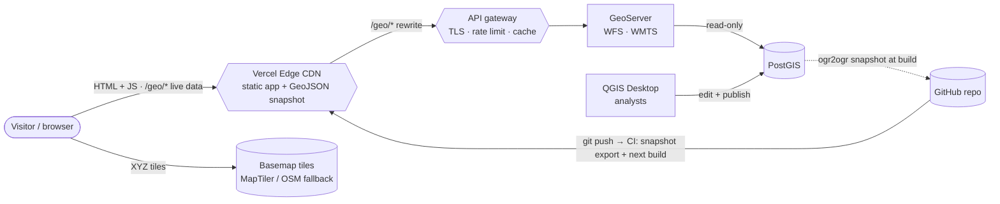
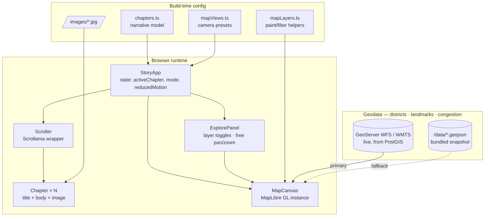
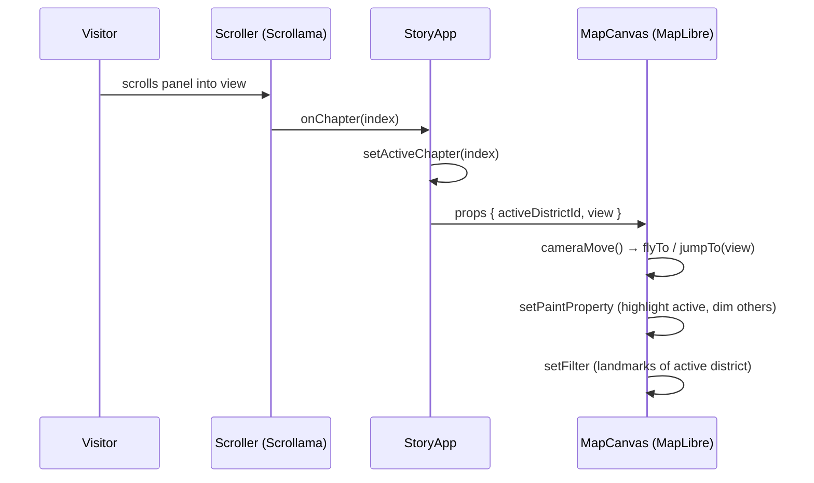
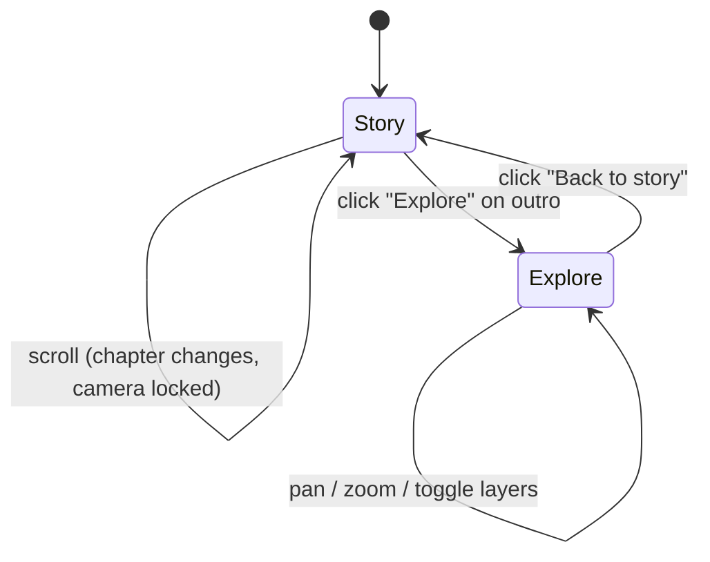
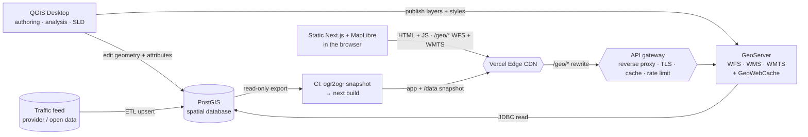
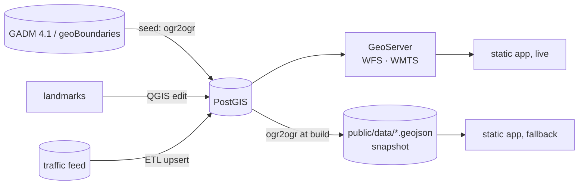
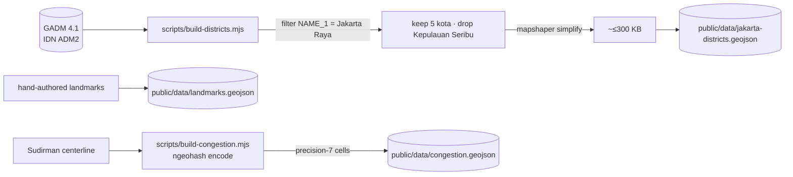
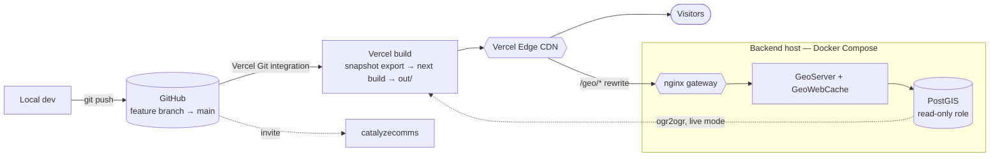
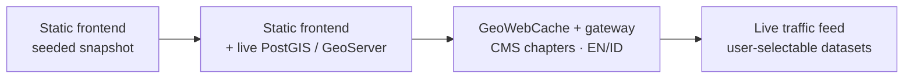
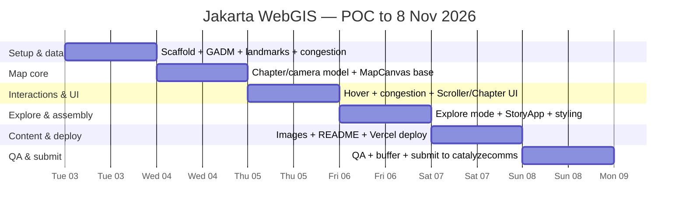

# Jakarta Scrollytelling WebGIS — End-to-End Architecture

**Author:** Dimas · **Date:** 2026-11-03 · **Status:** Design / spec for the Catalyze case study
**Companion plan:** [`docs/superpowers/plans/2026-11-03-jakarta-scrollytelling-webgis.md`](superpowers/plans/2026-11-03-jakarta-scrollytelling-webgis.md)

---

## 1. Purpose and scope

A web application that walks a visitor through the **five municipalities (kota administrasi) of DKI Jakarta** as a scripted, scroll-driven narrative, ending in an interactive map. It is the Catalyze "WebGIS Development" case study — a modern reconstruction of the storytelling approach seen on [`lancastersound.wwf.ca`](https://lancastersound.wwf.ca), applied to Jakarta.

**In scope (POC):** the scrollytelling experience, five district narratives + landmark highlights, boundary + point geodata, a **hover-to-highlight** interaction on district polygons, a **traffic-congestion layer** (geohash cells along Jalan Sudirman, red = *macet*), a free **explore mode** after the story, and Vercel deployment.
**Out of scope (POC):** CMS, authentication, write APIs, live/real-time traffic feeds (congestion is static sample data), multi-language UI (noted as an evolution step).

The narrative (simple, Bahasa Indonesia):

| # | District | Theme | Highlights |
|---|----------|-------|-----------|
| 1 | Jakarta Pusat | Business center | Sudirman, SCBD |
| 2 | Jakarta Barat | Education & culinary | Trisakti, Untar, Ciputra, Tanjung Duren |
| 3 | Jakarta Selatan | Pop culture & entertainment | Blok M, Kemang |
| 4 | Jakarta Utara | Trade & Chinatown | PIK, Glodok |
| 5 | Jakarta Timur | Manufacturing industry | Pulogadung |

The Jakarta Pusat chapter additionally reveals a **congestion overlay**: geohash cells tracing the Sudirman corridor, styled red to signal *macet* (heavy traffic). It is static sample data in the POC; the live-traffic version is part of the production backend in §6.

---

## 2. Architectural principle: static frontend, live geospatial backend

The architecture splits **where the app comes from** from **where the data comes from**:

- **Frontend — static.** The Next.js app is a static export (`output: 'export'`): prerendered HTML + JS on the Vercel edge CDN. No SSR, no serverless functions, no app server. This does not change when the backend goes live.
- **Data — live.** The geodata lives in an open-source geospatial backend: authored in **QGIS**, stored in **PostGIS** (the single source of truth), and served by **GeoServer** as OGC services (**WFS** GeoJSON, **WMTS** tiles). The static app fetches it from the browser at runtime.
- **Fallback — a snapshot of the live data.** At build time, CI exports a **GeoJSON snapshot from PostGIS** and bundles it into `/data/*.geojson`. The app uses it when GeoServer is unreachable, and for offline demos. Because the snapshot is exported *from* PostGIS, the fallback can never drift from the live data.

Why live data matters even with a static frontend: a production WebGIS needs server-side spatial queries (bbox/attribute filtering), centrally managed cartography, tiling for large datasets, and **live data** (e.g. traffic congestion) — none of which files baked into a build provide. Why the frontend stays static anyway: the story UI is the same for every visitor, so serving it from a CDN keeps it cheap, fast, and resilient; only the data needs a server.

The enabling decision: the frontend talks only to a MapLibre **`source` abstraction**, so a layer reading a GeoServer WFS/WMTS endpoint or the bundled `/data/*.geojson` snapshot is a URL change, not a rewrite.

**What this repository ships today (POC):** the static frontend running in **snapshot-only** mode. Because the backend is not stood up yet, the snapshot is seeded by build scripts straight from GADM and sample data (§7.1) instead of being exported from PostGIS. §6 specifies the live backend; §10 is the path from POC to live.

---

## 3. System context



The browser talks to **one origin, Vercel**: it serves the **app** (HTML/JS, plus the fallback snapshot) from the edge and forwards **live data** requests under `/geo/*` to the gateway in front of GeoServer via a Vercel rewrite. Only **basemap tiles** go elsewhere, to the tile provider. One domain means no CORS configuration and a GeoServer address the browser never sees. There is still no app server in the request path — the rewrite is a proxy rule, and GeoServer is a data service, not a renderer of pages. In the POC, only the static files and basemap paths exist.

---

## 4. Container / component architecture



**Separation of concerns (the reference site's best idea, kept):** the narrative is *data*, not code. `chapters.ts` + `mapViews.ts` declare what each chapter says, which image it shows, and where the camera goes. Components are generic; the story is config. Re-ordering or editing chapters never touches component code.

### Component responsibilities

| Component | Responsibility | Key interface |
|-----------|----------------|---------------|
| `StoryApp` | Hold `activeChapter` + `mode` (`story`/`explore`) state, detect `prefers-reduced-motion`, wire scroll → map | `activeDistrictId`, `view`, `mode`, `showCongestion` → `MapCanvas` |
| `Scroller` | Fire `onChapter(index)` as panels enter viewport (Scrollama) | `{chapters, onChapter}` |
| `Chapter` | Render one narrative panel (title, body, image) | `{chapter}` |
| `MapCanvas` | Own the MapLibre map; highlight active district, hover-highlight, fly camera, show landmarks + congestion; enable interaction in explore mode | `{activeDistrictId, view, mode, showCongestion, reducedMotion}` |
| `ExplorePanel` | Render layer toggles + hint shown in explore mode | `{layers, onToggle}` |
| `lib/mapLayers.ts` | Pure styling helpers (testable without WebGL) | `districtFillPaint`, `landmarkFilter`, `cameraMove`, `congestionPaint` |

---

## 5. Frontend architecture

### 5.1 The scroll → story → map pipeline



- **Rendering model:** Next.js static export (`output: 'export'`). Pages are prerendered HTML; the story runs client-side. No SSR/serverless at runtime — in live mode the browser fetches geodata from GeoServer itself (§6.4).
- **Map as a sticky background:** the map container is `position: sticky; top: 0; height: 100vh`; narrative panels scroll over it. One persistent MapLibre instance — never re-created per chapter.
- **State:** a single source of truth (`activeChapter` index in `StoryApp`). Derived values (district id, camera view) flow down as props. No global store needed at POC scale.
- **Camera choreography:** each chapter maps to a named view preset (center + zoom), mirroring the reference's `views: {default, arctic, lancaster}`. The map animates between presets; it does not compute geometry centroids at runtime (avoids drift toward offshore polygons — see §9).

### 5.2 Library choices

| Concern | Choice | Why |
|---------|--------|-----|
| Framework | Next.js 14 (static export) | Brief mandates Vercel; first-class there; static export = zero server cost |
| Map engine | **MapLibre GL JS 4** | Open-source, no access token, vector-capable, data-driven styling, smooth `flyTo` |
| Scroll trigger | **Scrollama 3** | IntersectionObserver-based, the de-facto scrollytelling library, tiny |
| Language | TypeScript | Typed chapter/geo models catch config errors at build |
| Test | Vitest + Testing Library + jsdom | Fast; unit-tests the pure logic (paint, filter, scroll math) |

### 5.3 Interactions

- **Hover-to-highlight (district polygons):** on `mousemove` over the district fill layer, MapLibre `setFeatureState({hover:true})` thickens that polygon's outline and lifts its fill opacity; a lightweight tooltip follows the cursor showing the district `name`. `mouseleave` clears the state. This uses feature-state, not a layer rebuild, so it is cheap and does not fight the active-chapter highlight. Hover is a pointer affordance; keyboard/touch users rely on the scripted highlight and the explore toggles, so no information is hover-only.
- **Explore mode (after the story):** the outro chapter offers an "Explore" entry. `StoryApp.mode` flips to `explore`: the map's pan/zoom/scroll-zoom handlers are enabled, all five districts render at base opacity, all landmarks show, and an `ExplorePanel` exposes toggles (district labels, landmarks, Sudirman congestion). This is the reference site's third mode (free *layers* exploration) folded into the end of the linear story — scripted first, open-ended after.



---

## 6. Backend architecture (PostGIS · GeoServer · QGIS)

The brief asks to focus on "backend integration/APIs." The backend is the open-source WebGIS stack: data authored in **QGIS**, stored in **PostGIS**, served as OGC web services by **GeoServer**, and consumed over HTTP by the **static** Next.js/MapLibre frontend running in the browser. QGIS is the authoring/analysis desktop tool (not in the request path); GeoServer is the serving layer. The backend serves *data only* — the app itself always comes from the CDN.

### 6.1 Roles

| Component | Role | Notes |
|-----------|------|-------|
| **QGIS Desktop** | Authoring & analysis | Ingest and clean source data, run spatial analysis, design cartography, and author styles (export **SLD/QML**). Connects directly to PostGIS over the DB connection and publishes layers/styles to GeoServer. The analyst's cockpit — used by people, not called by the app. |
| **PostGIS** | Spatial source of truth | PostgreSQL + PostGIS. Tables for districts / landmarks / congestion, **GiST** spatial indexes, SRID-managed geometry, SQL views for derived layers, and the mutable tables that hold **live data** (e.g. current congestion speeds). |
| **GeoServer** | OGC service layer | Publishes PostGIS layers as **WFS** (vector → GeoJSON), **WMS**, and **WMTS / vector tiles**; applies SLD styling; caches tiles via **GeoWebCache**. This is the real geospatial "API" the frontend hits. |
| **Frontend (Next.js + MapLibre)** | Consumer (static) | Still a static export on the CDN. MapLibre `source`s point at GeoServer WFS/WMTS endpoints, with the bundled snapshot as fallback. Scrollytelling, highlight, and explore logic are unchanged. |
| **Snapshot export (CI)** | Build-time bridge | `ogr2ogr` (GDAL) reads PostGIS and writes `public/data/*.geojson` before `next build`, so the fallback is always a copy of the live data. |

> *Alternative:* **QGIS Server** can itself serve OGC services straight from a QGIS project. Here GeoServer is the serving layer and QGIS stays the authoring tool — a cleaner split of "author" vs "serve" for a team.

### 6.2 Container topology



### 6.3 Request and update flow

```mermaid
sequenceDiagram
    participant M as MapLibre (browser)
    participant V as Vercel edge
    participant G as API gateway
    participant S as GeoServer
    participant P as PostGIS
    M->>V: GET /geo/wmts/… tile z/x/y (districts, thematic)
    V->>G: rewrite
    G-->>M: cached tile (GeoWebCache) or render-through
    M->>V: GET /geo/wfs?…GetFeature bbox=… (landmarks / congestion)
    V->>G: rewrite
    G->>S: proxy
    S->>P: SQL over GiST index (bbox + attribute filter)
    P-->>S: rows
    S-->>M: GeoJSON
    Note over P,S: live congestion — ETL upserts speeds into PostGIS;<br/>GeoServer serves fresh cells via WFS (and reseeds WMTS)
```

### 6.4 What the frontend consumes

- **Interactive vector layers** (districts, landmarks, congestion) → **WFS `GetFeature`** returning GeoJSON, loaded into the same MapLibre `geojson` sources. Moving from `/data/jakarta-districts.geojson` to `…/geoserver/wfs?...&outputFormat=application/json` is a URL swap.
- **Basemap and heavy thematic layers** → **WMTS / vector tiles** from GeoServer + GeoWebCache (so large or frequently-drawn layers are pre-rendered, not re-queried per view).
- The MapLibre `source` abstraction (already in `MapCanvas`) is what makes this swap a config change rather than a component rewrite.
- **Single origin via a Vercel rewrite:** the app requests live data at its own origin, `/geo/*`, and a rewrite in `vercel.json` forwards it to the gateway. Rewrites are edge proxy rules, so they work with a static export and add no serverless functions:

  ```json
  { "rewrites": [{ "source": "/geo/:path*", "destination": "https://geo.example.id/geoserver/:path*" }] }
  ```

  Trade-off: one extra hop through the Vercel edge, and live-data traffic counts toward Vercel bandwidth. GeoWebCache plus edge caching keeps the tile cost low.
- **Live on/off is build-time config**, like the basemap key: `NEXT_PUBLIC_GEO_LIVE` (planned) set → layers read `/geo/*`; unset → snapshot only (today's POC). If a live request fails or times out, the layer loads the bundled snapshot instead, so the story never shows an empty map.

### 6.5 Gateway, security, caching, and deployment

- **API gateway / reverse proxy** (nginx or a cloud load balancer) sits in front of GeoServer for **TLS, rate-limiting, and response caching**, and is reached only through the Vercel `/geo/*` rewrite — GeoServer's admin is never public, and no CORS policy is needed because the browser stays on one origin.
- **Least privilege:** GeoServer connects to PostGIS with a **read-only role**; writes happen only through QGIS (authors) or the ETL job (live feed).
- **Caching:** GeoWebCache for tiles + CDN edge caching; bounded/parameterized WFS requests to avoid unbounded scans.
- **Deployment:** **Docker Compose** for `postgis`, `geoserver`, and the gateway (reproducible locally and on a VM); QGIS runs on each analyst's machine. Managed option: PostGIS on RDS / Cloud SQL, GeoServer on a container service or VM, tiles fronted by a CDN.

### 6.6 Snapshot fallback (and what this repo ships)

The bundled GeoJSON is a **snapshot of PostGIS**, not a separate dataset. In CI, before `next build`:

```bash
ogr2ogr -f GeoJSON public/data/jakarta-districts.geojson \
  PG:"$POSTGIS_READONLY_URL" -sql "SELECT id, name, geom FROM districts" \
  -lco COORDINATE_PRECISION=5
```

(and likewise for landmarks and congestion; GeoServer's WFS `outputFormat=application/json` works too.) The snapshot serves three purposes: **fallback** when GeoServer is unreachable, **offline demos**, and **fast first paint** for slow-changing layers such as boundaries.

**This repo today** runs the frontend in snapshot-only mode, with the snapshot seeded by `scripts/build-*.mjs` from GADM and sample data because PostGIS does not exist yet. When the backend is stood up, those scripts become one-off **seed loaders into PostGIS**, and the snapshot switches to the `ogr2ogr` export above — no app code changes.

### 6.7 Trade-offs (honest)

A live backend buys server-side spatial queries, centrally managed styling, tiling, multi-source management, and live data — at the cost of **infrastructure to run, scale, secure, back up, and pay for** (database, GeoServer, gateway). Keeping the frontend static limits that cost to the data tier: the app shell never needs a server, and a backend outage degrades to the snapshot instead of a blank page. The pragmatic answer is **per dataset**: boundaries rarely change → the snapshot (or cached WMTS) is enough; congestion is live → PostGIS + WFS.

---

## 7. Data architecture

### 7.1 Sourcing and pipeline

**Live target:** every source lands in PostGIS first; the bundled GeoJSON is exported from it.



**POC today:** PostGIS is not stood up yet, so build scripts produce the snapshot directly.



- **Boundaries:** **GADM 4.1** Indonesia level-2 (`gadm41_IDN_2`), filtered where `NAME_1 = "Jakarta Raya"` and `NAME_2` is one of the five kota (Kepulauan Seribu excluded), simplified with **mapshaper**. Build-time script, committed output. GADM properties `GID_2`/`NAME_2` are mapped to our canonical `{id, name}`.
  - **License caveat:** GADM is free for academic/non-commercial use but its license restricts redistribution and commercial use. For this assessment (non-commercial POC) we ship a simplified derivative with attribution in `CREDITS.md`; the ADR (§11) notes geoBoundaries (CC BY) or BPS/Jakarta Satu as the drop-in open-licensed source for a public/commercial build.
- **Landmarks:** small, hand-authored GeoJSON points — fast to iterate for a POC.
- **Congestion (Sudirman):** `scripts/build-congestion.mjs` samples the Jalan Sudirman centerline (Bundaran HI → Semanggi), encodes each sample to a **geohash (precision 7, ~150 m cells)** with **ngeohash**, dedupes, and emits one square polygon per cell (from the geohash bounds) tagged `status: "macet"`. Static sample data for the POC.
- **Images:** one CC-licensed / public-domain photo per district (Wikimedia Commons), attributions in `public/images/CREDITS.md`.

### 7.2 Schemas

`jakarta-districts.geojson` — `FeatureCollection`:
```jsonc
{ "type": "Feature",
  "properties": { "id": "jaksel", "name": "Jakarta Selatan" },
  "geometry": { "type": "MultiPolygon", "coordinates": [...] } }
```

`landmarks.geojson` — `FeatureCollection`:
```jsonc
{ "type": "Feature",
  "properties": { "district": "jaksel", "name": "Blok M" },
  "geometry": { "type": "Point", "coordinates": [106.7983, -6.2446] } }
```

`congestion.geojson` — `FeatureCollection` (one polygon per geohash cell):
```jsonc
{ "type": "Feature",
  "properties": { "geohash": "qqgux9k", "status": "macet", "corridor": "Sudirman" },
  "geometry": { "type": "Polygon", "coordinates": [[ /* geohash cell bounds */ ]] } }
```

### 7.3 Projection / CRS strategy

- **Storage:** WGS84 (EPSG:4326) lon/lat — the GeoJSON standard.
- **Render:** Web Mercator (EPSG:3857), MapLibre default.
- **Deliberate contrast with the reference:** Lancaster Sound defines a custom **polar stereographic** projection (EPSG:5937) via Proj4, because near the pole Mercator is unusable. **Jakarta sits on the equator (~6°S), where Mercator distortion is negligible — so we intentionally drop the custom-projection machinery.** Knowing *when not* to add complexity is part of the design.

---

## 8. Deployment and delivery



The frontend and backend deploy independently: the **frontend** ships through Vercel exactly as before; the **backend** runs as a Docker Compose stack (or managed PostGIS + a GeoServer container) on its own host.

- **CI/CD (frontend):** GitHub → Vercel Git integration. Every push runs the snapshot export (live mode only, using a read-only PostGIS role), then `next build` (static export to `out/`), and deploys; PRs get preview URLs. In the POC the snapshot step is skipped and the committed GeoJSON is used.
- **Hosting:** static assets on Vercel's edge CDN, plus a `/geo/*` rewrite to the backend gateway. No serverless functions — the live data API is GeoServer, not a Vercel function.
- **Caching:** hashed immutable JS/CSS assets; GeoJSON served with cache headers. Basemap tiles cached by the provider + browser.
- **Submission:** repo on GitHub (invite `catalyzecomms`), live URL on Vercel, both emailed by 8 Nov 2026.

---

## 9. Cross-cutting concerns

| Concern | Approach |
|---------|----------|
| **Accessibility — motion** | Honor `prefers-reduced-motion`: camera uses `jumpTo` instead of `flyTo`; `cameraMove()` encapsulates this |
| **Accessibility — content** | Each chapter image has meaningful `alt`; narrative is real DOM text (screen-reader + SEO friendly), not baked into images (an improvement over the reference's PNG-text scenes) |
| **Mobile** | Sticky map stays visible; panels readable at ≤480px; touch scroll drives Scrollama; hover has no touch equivalent, so no data is hover-only (explore toggles + scripted highlight cover it) |
| **Performance** | One map instance; simplified geometry; data-driven paint over layer churn; small GeoJSON; lazy image loading |
| **Resilience** | Live → snapshot: a failed or slow GeoServer request falls back to the bundled GeoJSON; if that fails too, the basemap still renders, no crash |
| **Rapid scroll** | `MapCanvas` keeps a latest-view ref so only the most recent chapter's camera move applies (no `flyTo` queue lag) |
| **SEO** | Static prerendered HTML with real narrative text + metadata |
| **Analytics** | Optional privacy-friendly beacon (Plausible) or GA4 |
| **Security** | No secrets in client beyond a domain-restricted tile key; static hosting shrinks attack surface. GeoServer admin stays private behind the gateway; GeoServer and CI read PostGIS with read-only roles |

---

## 10. Evolution roadmap (POC → production)



1. **POC (this build):** static frontend in snapshot-only mode — scripted narrative, five districts, hover-highlight, static Sudirman congestion overlay, explore mode.
2. **v1 — stand up the backend (§6):** seed **PostGIS** with the existing scripts' sources, author and style in **QGIS**, publish through **GeoServer** (WFS + WMTS), add the `/geo/*` rewrite and set `NEXT_PUBLIC_GEO_LIVE`, and switch CI to export the snapshot from PostGIS. The frontend stays a static export; only where it reads data changes.
3. **v2:** GeoWebCache + API gateway tuning; narrative + images managed in a headless CMS with a deploy hook; EN/ID language toggle; richer explore-mode layer catalog.
4. **v3:** **live traffic feed** replacing the static congestion sample (ETL into PostGIS, GeoServer serves fresh cells recolored by real-time speed); user-chosen datasets; bookmarkable map state in the URL (the reference encodes `#!/home?view=lat|lng|zoom` — worth keeping).

---

## 11. Key technical decisions (ADR summary)

| Decision | Chosen | Alternatives considered | Rationale |
|----------|--------|-------------------------|-----------|
| Map engine | MapLibre GL | Mapbox GL (token/cost), Leaflet (raster, like reference), ArcGIS JS (heavy/licensed) | Open, free, vector, smooth camera; no vendor lock-in |
| Backend | Live **PostGIS + GeoServer** behind a static frontend (snapshot fallback) | Pure static; serverless feature API; ArcGIS/managed | Open-source OGC stack: server-side spatial queries, central styling, tiling, live data; the app stays static, and the fallback is exported from PostGIS so it cannot drift (§6) |
| Spatial DB | **PostGIS** | SpatiaLite, Mongo/Elastic geo | De-facto OSS spatial DB; GiST indexes, rich SQL analysis; first-class in both QGIS and GeoServer |
| OGC server | **GeoServer** | QGIS Server, pg_tileserv/Martin, MapServer | Mature WFS/WMS/WMTS + GeoWebCache + SLD, broad formats; QGIS Server noted as the alternative (§6.1) |
| Authoring | **QGIS Desktop** | ArcGIS Pro, FME, hand-coded ETL | Free, strong cartography/analysis, native PostGIS editing + GeoServer publishing |
| Data format | WFS GeoJSON + WMTS (live) / GeoJSON snapshot (fallback) | TopoJSON, Shapefile, PMTiles | Same GeoJSON shape in both paths, so MapLibre sources are interchangeable; WMTS for heavy layers |
| Fallback source | **`ogr2ogr` snapshot from PostGIS** at build | Separate static pipeline; no fallback | One source of truth — the fallback is a copy of the live data, not a second dataset |
| Data entry point | **Vercel `/geo/*` rewrite** → gateway (one origin) | Browser calls the gateway's own domain (CORS) | One domain, no CORS, GeoServer address hidden; costs one edge hop and Vercel bandwidth |
| Boundary source | **GADM 4.1** (ADM2) | geoBoundaries (CC BY), BPS, Jakarta Satu, OSM | User choice; complete IDN ADM2. Caveat: GADM restricts redistribution/commercial use (§7.1) — swap to geoBoundaries for a public/commercial build |
| Congestion encoding | **Geohash cells** (precision 7) | GPS polyline, H3 hexagons, segment IDs | Compact, grid-aligned, trivially colorable; cells map cleanly to a GL fill layer; ngeohash is tiny |
| Projection | Web Mercator | Custom polar stereographic (reference) | Equatorial location makes custom CRS unnecessary complexity |
| Framework | Next.js static export — also in live mode | Plain Vite/React, Astro; SSR Next.js | Brief mandates Vercel; the story UI is identical for every visitor, so it stays static even when data goes live — only the data tier needs servers |
| Narrative | Config-driven data | Hardcoded in components | Editable without code changes; the reference's strongest pattern |

---

## 12. What the reference site is, and how this differs

**`lancastersound.wwf.ca` (reverse-engineered):** a ~2016 RequireJS SPA using **Leaflet 0.7.7 + Proj4Leaflet** on a custom Arctic projection (EPSG:5937), a **Mapbox classic raster** basemap, and **static TopoJSON/GeoJSON** data (with an optional ArcGIS REST path). Three modes — scripted *story*, *gallery* of clustered media, free-explore *layers* — all driven by declarative JSON config. Narrative scenes are largely pre-rendered PNGs.

**This project keeps** the config-driven narrative model, named camera views, static delivery of the app, and the story→explore arc (and adds a live PostGIS + GeoServer data backend behind it, §6). **It modernizes** the stack (MapLibre + Next.js + Scrollama over RequireJS + Leaflet), uses **real DOM text** for narrative (accessibility/SEO) instead of PNG scenes, and **drops the custom projection** because Jakarta is equatorial — demonstrating judgement about where complexity is and isn't warranted.

---

## 13. Build timeline (now → deadline 8 Nov 2026)

Six working days, Tue 3 Nov → Sun 8 Nov. Each day ends with something committed and (from Day 5) deployed, so there is always a submittable state.



| Day | Date | Focus | Deliverable |
|-----|------|-------|-------------|
| 1 | Tue 3 Nov | Scaffold (Next.js static export, Vitest); data pipeline — GADM → 5 kota, landmarks, Sudirman congestion geohash | Repo builds; three GeoJSON files validated by tests |
| 2 | Wed 4 Nov | Chapter model + camera presets; MapCanvas base — map, district fill/line, active-district highlight, `flyTo` | Map renders; scripted highlight + camera works |
| 3 | Thu 5 Nov | Hover-to-highlight (feature-state + tooltip); congestion layer (red cells); landmark markers; Scroller + Chapter panels | Scroll advances chapters; hover + congestion visible |
| 4 | Fri 6 Nov | Explore mode + ExplorePanel toggles; assemble StoryApp (story↔explore); layout/styling | Full story + explore flow runs end to end |
| 5 | Sat 7 Nov | District images + credits; README (architecture, data strategy, timeline); first Vercel deploy | Live preview URL; README complete |
| 6 | Sun 8 Nov | QA (mobile, reduced-motion, rapid scroll, data-failure); bug buffer; final deploy; invite `catalyzecomms`; email links | **Submitted by EoD** |

**Assumptions:** solo build, roughly a focused half-to-full day each. Days 5–6 hold the buffer; if earlier days slip, congestion/explore are the first polish items to trim, not the core story.
