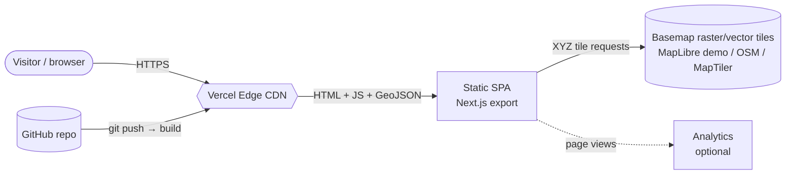
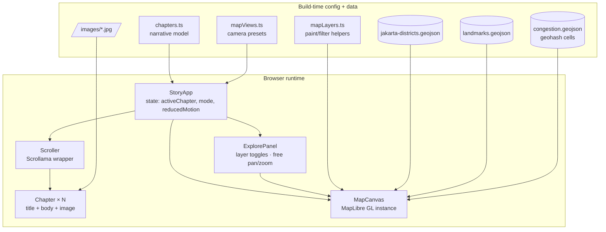
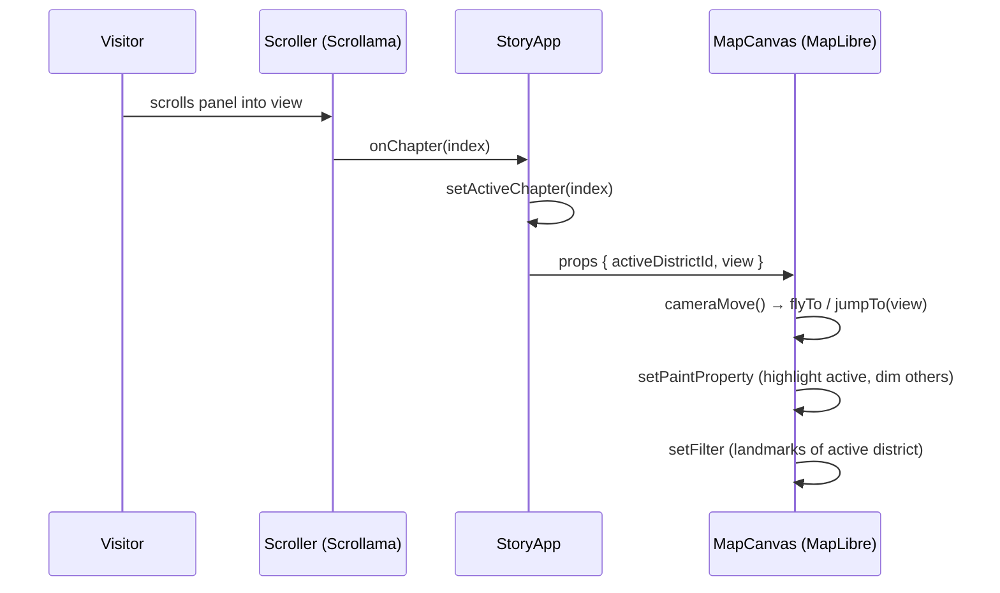
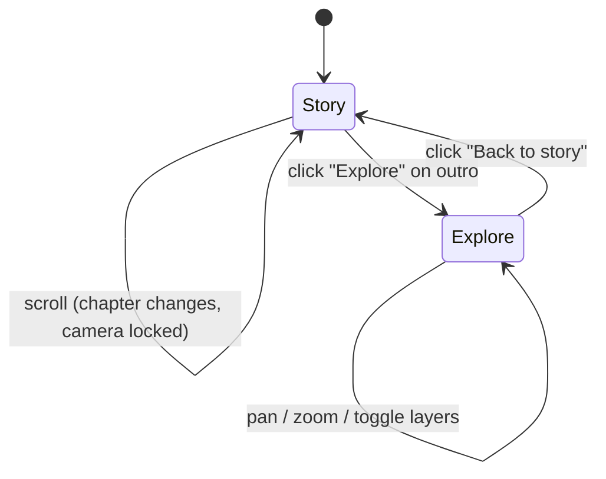
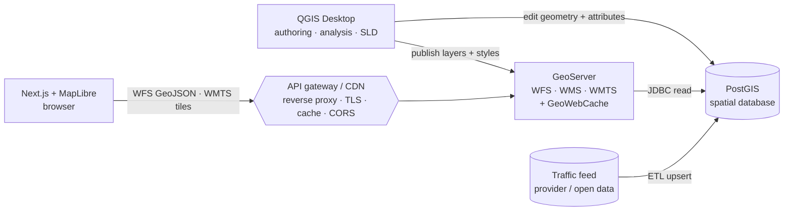
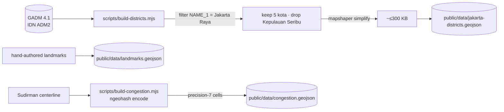
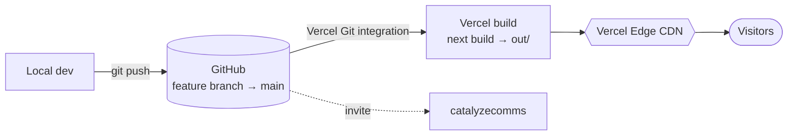
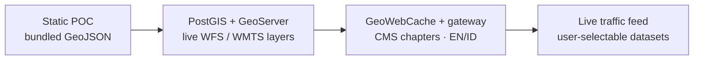
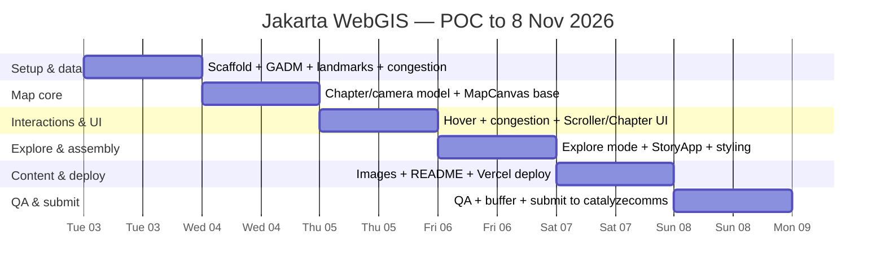

# Jakarta Scrollytelling WebGIS — End-to-End Architecture

**Author:** Dimas · **Date:** 2026-11-03 · **Status:** Design / spec for the Catalyze case study
**Companion plan:** [`docs/superpowers/plans/2026-11-03-jakarta-scrollytelling-webgis.md`](superpowers/plans/2026-11-03-jakarta-scrollytelling-webgis.md)

---

## 1. Purpose and scope

A web application that walks a visitor through the **five municipalities (kota administrasi) of DKI Jakarta** as a scripted, scroll-driven narrative, ending in an interactive map. It is the Catalyze "WebGIS Development" case study — a modern reconstruction of the storytelling approach seen on [`lancastersound.wwf.ca`](https://lancastersound.wwf.ca), applied to Jakarta.

**In scope (POC):** the scrollytelling experience, five district narratives + landmark highlights, boundary + point geodata, a **hover-to-highlight** interaction on district polygons, a **traffic-congestion layer** (geohash cells along Jalan Sudirman, red = *macet*), a free **explore mode** after the story, and Vercel deployment.
**Out of scope (POC):** CMS, authentication, write APIs, live/real-time traffic feeds (congestion is static sample data), multi-language UI (noted as an evolution step).

The narrative (simple, Bahasa Indonesia):

| # | District | Theme | Highlights |
|---|----------|-------|-----------|
| 1 | Jakarta Pusat | Business center | Sudirman, SCBD |
| 2 | Jakarta Barat | Education & culinary | Trisakti, Untar, Ciputra, Tanjung Duren |
| 3 | Jakarta Selatan | Pop culture & entertainment | Blok M, Kemang |
| 4 | Jakarta Utara | Trade & Chinatown | PIK, Glodok |
| 5 | Jakarta Timur | Manufacturing industry | Pulogadung |

The Jakarta Pusat chapter additionally reveals a **congestion overlay**: geohash cells tracing the Sudirman corridor, styled red to signal *macet* (heavy traffic). It is static sample data in the POC; the live-traffic version is part of the production backend in §6.

---

## 2. Architectural principle: live backend primary, static fallback

The production architecture is a **live open-source geospatial backend** — data authored in **QGIS**, stored in **PostGIS**, served to the web by **GeoServer** as standard OGC services — with the Next.js/MapLibre frontend as its consumer. A fully **static export** (bundled GeoJSON on a CDN) is retained as a deliberate **fallback / offline / demo** mode, and is what this repository actually ships today.

Why a real backend is the primary target: a production WebGIS needs server-side spatial queries (bbox/attribute filtering), centrally managed cartography, tiling for large datasets, multi-source layer management, and **live data** (e.g. traffic congestion) — none of which static files provide at scale. The static fallback stays valuable for low-cost, read-only, slow-changing content and offline demos.

The enabling decision that keeps both modes cheap: the frontend talks only to a MapLibre **`source` abstraction**, so pointing a layer at a GeoServer WFS/WMTS endpoint instead of a static `/data/*.geojson` file is a config change, not a rewrite. §6 specifies the live backend; §8 covers the static-delivery path this repo ships.

---

## 3. System context (static-delivery mode)

This section shows the **static fallback** topology that this repo ships. The production topology — QGIS → PostGIS → GeoServer in the request path — is in §6.



Everything the visitor touches is served from the Vercel CDN except basemap tiles, which come from a tile provider. There is no origin server in the request path.

---

## 4. Container / component architecture



**Separation of concerns (the reference site's best idea, kept):** the narrative is *data*, not code. `chapters.ts` + `mapViews.ts` declare what each chapter says, which image it shows, and where the camera goes. Components are generic; the story is config. Re-ordering or editing chapters never touches component code.

### Component responsibilities

| Component | Responsibility | Key interface |
|-----------|----------------|---------------|
| `StoryApp` | Hold `activeChapter` + `mode` (`story`/`explore`) state, detect `prefers-reduced-motion`, wire scroll → map | `activeDistrictId`, `view`, `mode`, `showCongestion` → `MapCanvas` |
| `Scroller` | Fire `onChapter(index)` as panels enter viewport (Scrollama) | `{chapters, onChapter}` |
| `Chapter` | Render one narrative panel (title, body, image) | `{chapter}` |
| `MapCanvas` | Own the MapLibre map; highlight active district, hover-highlight, fly camera, show landmarks + congestion; enable interaction in explore mode | `{activeDistrictId, view, mode, showCongestion, reducedMotion}` |
| `ExplorePanel` | Render layer toggles + hint shown in explore mode | `{layers, onToggle}` |
| `lib/mapLayers.ts` | Pure styling helpers (testable without WebGL) | `districtFillPaint`, `landmarkFilter`, `cameraMove`, `congestionPaint` |

---

## 5. Frontend architecture

### 5.1 The scroll → story → map pipeline



- **Rendering model:** Next.js static export (`output: 'export'`). Pages are prerendered HTML; the story runs client-side. No SSR/serverless at runtime.
- **Map as a sticky background:** the map container is `position: sticky; top: 0; height: 100vh`; narrative panels scroll over it. One persistent MapLibre instance — never re-created per chapter.
- **State:** a single source of truth (`activeChapter` index in `StoryApp`). Derived values (district id, camera view) flow down as props. No global store needed at POC scale.
- **Camera choreography:** each chapter maps to a named view preset (center + zoom), mirroring the reference's `views: {default, arctic, lancaster}`. The map animates between presets; it does not compute geometry centroids at runtime (avoids drift toward offshore polygons — see §9).

### 5.2 Library choices

| Concern | Choice | Why |
|---------|--------|-----|
| Framework | Next.js 14 (static export) | Brief mandates Vercel; first-class there; static export = zero server cost |
| Map engine | **MapLibre GL JS 4** | Open-source, no access token, vector-capable, data-driven styling, smooth `flyTo` |
| Scroll trigger | **Scrollama 3** | IntersectionObserver-based, the de-facto scrollytelling library, tiny |
| Language | TypeScript | Typed chapter/geo models catch config errors at build |
| Test | Vitest + Testing Library + jsdom | Fast; unit-tests the pure logic (paint, filter, scroll math) |

### 5.3 Interactions

- **Hover-to-highlight (district polygons):** on `mousemove` over the district fill layer, MapLibre `setFeatureState({hover:true})` thickens that polygon's outline and lifts its fill opacity; a lightweight tooltip follows the cursor showing the district `name`. `mouseleave` clears the state. This uses feature-state, not a layer rebuild, so it is cheap and does not fight the active-chapter highlight. Hover is a pointer affordance; keyboard/touch users rely on the scripted highlight and the explore toggles, so no information is hover-only.
- **Explore mode (after the story):** the outro chapter offers an "Explore" entry. `StoryApp.mode` flips to `explore`: the map's pan/zoom/scroll-zoom handlers are enabled, all five districts render at base opacity, all landmarks show, and an `ExplorePanel` exposes toggles (district labels, landmarks, Sudirman congestion). This is the reference site's third mode (free *layers* exploration) folded into the end of the linear story — scripted first, open-ended after.



---

## 6. Backend architecture (PostGIS · GeoServer · QGIS)

The brief asks to focus on "backend integration/APIs." The production backend is the open-source WebGIS stack: data authored in **QGIS**, stored in **PostGIS**, served as OGC web services by **GeoServer**, and consumed by the Next.js/MapLibre frontend over HTTP. QGIS is the authoring/analysis desktop tool (not in the request path); GeoServer is the serving layer.

### 6.1 Roles

| Component | Role | Notes |
|-----------|------|-------|
| **QGIS Desktop** | Authoring & analysis | Ingest and clean source data, run spatial analysis, design cartography, and author styles (export **SLD/QML**). Connects directly to PostGIS over the DB connection and publishes layers/styles to GeoServer. The analyst's cockpit — used by people, not called by the app. |
| **PostGIS** | Spatial source of truth | PostgreSQL + PostGIS. Tables for districts / landmarks / congestion, **GiST** spatial indexes, SRID-managed geometry, SQL views for derived layers, and the mutable tables that hold **live data** (e.g. current congestion speeds). |
| **GeoServer** | OGC service layer | Publishes PostGIS layers as **WFS** (vector → GeoJSON), **WMS**, and **WMTS / vector tiles**; applies SLD styling; caches tiles via **GeoWebCache**. This is the real geospatial "API" the frontend hits. |
| **Frontend (Next.js + MapLibre)** | Consumer | MapLibre `source`s point at GeoServer WFS/WMTS endpoints instead of static GeoJSON. Scrollytelling, highlight, and explore logic are unchanged. |

> *Alternative:* **QGIS Server** can itself serve OGC services straight from a QGIS project. Here GeoServer is the serving layer and QGIS stays the authoring tool — a cleaner split of "author" vs "serve" for a team.

### 6.2 Container topology



### 6.3 Request and update flow

```mermaid
sequenceDiagram
    participant M as MapLibre (browser)
    participant G as API gateway
    participant S as GeoServer
    participant P as PostGIS
    M->>G: GET WMTS tile z/x/y (districts, thematic)
    G-->>M: cached tile (GeoWebCache) or render-through
    M->>G: GET WFS GetFeature bbox=… (landmarks / congestion)
    G->>S: proxy
    S->>P: SQL over GiST index (bbox + attribute filter)
    P-->>S: rows
    S-->>M: GeoJSON
    Note over P,S: live congestion — ETL upserts speeds into PostGIS;<br/>GeoServer serves fresh cells via WFS (and reseeds WMTS)
```

### 6.4 What the frontend consumes

- **Interactive vector layers** (districts, landmarks, congestion) → **WFS `GetFeature`** returning GeoJSON, loaded into the same MapLibre `geojson` sources. Moving from `/data/jakarta-districts.geojson` to `…/geoserver/wfs?...&outputFormat=application/json` is a URL swap.
- **Basemap and heavy thematic layers** → **WMTS / vector tiles** from GeoServer + GeoWebCache (so large or frequently-drawn layers are pre-rendered, not re-queried per view).
- The MapLibre `source` abstraction (already in `MapCanvas`) is what makes this swap a config change rather than a component rewrite.

### 6.5 Gateway, security, caching, and deployment

- **API gateway / reverse proxy** (nginx, a Vercel rewrite, or a cloud load balancer) sits in front of GeoServer for **TLS, CORS, rate-limiting, and response caching** — GeoServer's admin is never public.
- **Least privilege:** GeoServer connects to PostGIS with a **read-only role**; writes happen only through QGIS (authors) or the ETL job (live feed).
- **Caching:** GeoWebCache for tiles + CDN edge caching; bounded/parameterized WFS requests to avoid unbounded scans.
- **Deployment:** **Docker Compose** for `postgis`, `geoserver`, and the gateway (reproducible locally and on a VM); QGIS runs on each analyst's machine. Managed option: PostGIS on RDS / Cloud SQL, GeoServer on a container service or VM, tiles fronted by a CDN.

### 6.6 Static fallback (what this repo ships)

The static export (bundled GeoJSON on a CDN, §8) is kept as an **offline / demo / low-cost** mode and is the POC in this repository. Because both modes feed the same MapLibre `source`s, the identical frontend runs against either the static files or the live GeoServer endpoints — the backend can be stood up without touching app code.

### 6.7 Trade-offs (honest)

A live backend buys server-side spatial queries, centrally managed styling, tiling, multi-source management, and live data — at the cost of **infrastructure to run, scale, secure, back up, and pay for** (database, GeoServer, gateway). Static delivery wins on cost, ops simplicity, and resilience for small, read-only, slow-changing data. The pragmatic answer is **per dataset**: boundaries rarely change → tile and cache aggressively; congestion is live → PostGIS + WFS.

---

## 7. Data architecture

### 7.1 Sourcing and pipeline



- **Boundaries:** **GADM 4.1** Indonesia level-2 (`gadm41_IDN_2`), filtered where `NAME_1 = "Jakarta Raya"` and `NAME_2` is one of the five kota (Kepulauan Seribu excluded), simplified with **mapshaper**. Build-time script, committed output. GADM properties `GID_2`/`NAME_2` are mapped to our canonical `{id, name}`.
  - **License caveat:** GADM is free for academic/non-commercial use but its license restricts redistribution and commercial use. For this assessment (non-commercial POC) we ship a simplified derivative with attribution in `CREDITS.md`; the ADR (§11) notes geoBoundaries (CC BY) or BPS/Jakarta Satu as the drop-in open-licensed source for a public/commercial build.
- **Landmarks:** small, hand-authored GeoJSON points — fast to iterate for a POC.
- **Congestion (Sudirman):** `scripts/build-congestion.mjs` samples the Jalan Sudirman centerline (Bundaran HI → Semanggi), encodes each sample to a **geohash (precision 7, ~150 m cells)** with **ngeohash**, dedupes, and emits one square polygon per cell (from the geohash bounds) tagged `status: "macet"`. Static sample data for the POC.
- **Images:** one CC-licensed / public-domain photo per district (Wikimedia Commons), attributions in `public/images/CREDITS.md`.

### 7.2 Schemas

`jakarta-districts.geojson` — `FeatureCollection`:
```jsonc
{ "type": "Feature",
  "properties": { "id": "jaksel", "name": "Jakarta Selatan" },
  "geometry": { "type": "MultiPolygon", "coordinates": [...] } }
```

`landmarks.geojson` — `FeatureCollection`:
```jsonc
{ "type": "Feature",
  "properties": { "district": "jaksel", "name": "Blok M" },
  "geometry": { "type": "Point", "coordinates": [106.7983, -6.2446] } }
```

`congestion.geojson` — `FeatureCollection` (one polygon per geohash cell):
```jsonc
{ "type": "Feature",
  "properties": { "geohash": "qqgux9k", "status": "macet", "corridor": "Sudirman" },
  "geometry": { "type": "Polygon", "coordinates": [[ /* geohash cell bounds */ ]] } }
```

### 7.3 Projection / CRS strategy

- **Storage:** WGS84 (EPSG:4326) lon/lat — the GeoJSON standard.
- **Render:** Web Mercator (EPSG:3857), MapLibre default.
- **Deliberate contrast with the reference:** Lancaster Sound defines a custom **polar stereographic** projection (EPSG:5937) via Proj4, because near the pole Mercator is unusable. **Jakarta sits on the equator (~6°S), where Mercator distortion is negligible — so we intentionally drop the custom-projection machinery.** Knowing *when not* to add complexity is part of the design.

---

## 8. Deployment and delivery



- **CI/CD:** GitHub → Vercel Git integration. Every push builds `next build` (static export to `out/`) and deploys; PRs get preview URLs.
- **Hosting:** static assets on Vercel's edge CDN. No serverless functions at POC (would be added only for Tier-1 feature APIs).
- **Caching:** hashed immutable JS/CSS assets; GeoJSON served with cache headers. Basemap tiles cached by the provider + browser.
- **Submission:** repo on GitHub (invite `catalyzecomms`), live URL on Vercel, both emailed by 8 Nov 2026.

---

## 9. Cross-cutting concerns

| Concern | Approach |
|---------|----------|
| **Accessibility — motion** | Honor `prefers-reduced-motion`: camera uses `jumpTo` instead of `flyTo`; `cameraMove()` encapsulates this |
| **Accessibility — content** | Each chapter image has meaningful `alt`; narrative is real DOM text (screen-reader + SEO friendly), not baked into images (an improvement over the reference's PNG-text scenes) |
| **Mobile** | Sticky map stays visible; panels readable at ≤480px; touch scroll drives Scrollama; hover has no touch equivalent, so no data is hover-only (explore toggles + scripted highlight cover it) |
| **Performance** | One map instance; simplified geometry; data-driven paint over layer churn; small GeoJSON; lazy image loading |
| **Resilience** | GeoJSON fetch wrapped in try/catch — basemap still renders on failure, no crash |
| **Rapid scroll** | `MapCanvas` keeps a latest-view ref so only the most recent chapter's camera move applies (no `flyTo` queue lag) |
| **SEO** | Static prerendered HTML with real narrative text + metadata |
| **Analytics** | Optional privacy-friendly beacon (Plausible) or GA4 |
| **Security** | No secrets in client beyond a domain-restricted tile key; static hosting shrinks attack surface |

---

## 10. Evolution roadmap (POC → production)



1. **POC (this build):** static data, scripted narrative, five districts, hover-highlight, static Sudirman congestion overlay, explore mode.
2. **v1 — stand up the backend (§6):** load the geodata into **PostGIS**, publish it through **GeoServer** (WFS + WMTS), author styles in **QGIS**, and point the MapLibre sources at GeoServer. The static export becomes the fallback.
3. **v2:** GeoWebCache + API gateway tuning; narrative + images managed in a headless CMS with a deploy hook; EN/ID language toggle; richer explore-mode layer catalog.
4. **v3:** **live traffic feed** replacing the static congestion sample (ETL into PostGIS, GeoServer serves fresh cells recolored by real-time speed); user-chosen datasets; bookmarkable map state in the URL (the reference encodes `#!/home?view=lat|lng|zoom` — worth keeping).

---

## 11. Key technical decisions (ADR summary)

| Decision | Chosen | Alternatives considered | Rationale |
|----------|--------|-------------------------|-----------|
| Map engine | MapLibre GL | Mapbox GL (token/cost), Leaflet (raster, like reference), ArcGIS JS (heavy/licensed) | Open, free, vector, smooth camera; no vendor lock-in |
| Backend | Live **PostGIS + GeoServer** (static fallback) | Pure static; serverless feature API; ArcGIS/managed | Open-source OGC stack: server-side spatial queries, central styling, tiling, live data; static kept for offline/demo (§6) |
| Spatial DB | **PostGIS** | SpatiaLite, Mongo/Elastic geo | De-facto OSS spatial DB; GiST indexes, rich SQL analysis; first-class in both QGIS and GeoServer |
| OGC server | **GeoServer** | QGIS Server, pg_tileserv/Martin, MapServer | Mature WFS/WMS/WMTS + GeoWebCache + SLD, broad formats; QGIS Server noted as the alternative (§6.1) |
| Authoring | **QGIS Desktop** | ArcGIS Pro, FME, hand-coded ETL | Free, strong cartography/analysis, native PostGIS editing + GeoServer publishing |
| Data format | GeoJSON (static mode) / WFS+WMTS (live) | TopoJSON, Shapefile, PMTiles | GeoJSON simplest for the static POC; GeoServer serves WFS GeoJSON + WMTS tiles in production |
| Boundary source | **GADM 4.1** (ADM2) | geoBoundaries (CC BY), BPS, Jakarta Satu, OSM | User choice; complete IDN ADM2. Caveat: GADM restricts redistribution/commercial use (§7.1) — swap to geoBoundaries for a public/commercial build |
| Congestion encoding | **Geohash cells** (precision 7) | GPS polyline, H3 hexagons, segment IDs | Compact, grid-aligned, trivially colorable; cells map cleanly to a GL fill layer; ngeohash is tiny |
| Projection | Web Mercator | Custom polar stereographic (reference) | Equatorial location makes custom CRS unnecessary complexity |
| Framework | Next.js static export | Plain Vite/React, Astro | Brief mandates Vercel; static export keeps it serverless; easy Tier-1 serverless later |
| Narrative | Config-driven data | Hardcoded in components | Editable without code changes; the reference's strongest pattern |

---

## 12. What the reference site is, and how this differs

**`lancastersound.wwf.ca` (reverse-engineered):** a ~2016 RequireJS SPA using **Leaflet 0.7.7 + Proj4Leaflet** on a custom Arctic projection (EPSG:5937), a **Mapbox classic raster** basemap, and **static TopoJSON/GeoJSON** data (with an optional ArcGIS REST path). Three modes — scripted *story*, *gallery* of clustered media, free-explore *layers* — all driven by declarative JSON config. Narrative scenes are largely pre-rendered PNGs.

**This project keeps** the config-driven narrative model, named camera views, a static-delivery fallback mode, and the story→explore arc (and adds a live PostGIS + GeoServer backend as the production target, §6). **It modernizes** the stack (MapLibre + Next.js + Scrollama over RequireJS + Leaflet), uses **real DOM text** for narrative (accessibility/SEO) instead of PNG scenes, and **drops the custom projection** because Jakarta is equatorial — demonstrating judgement about where complexity is and isn't warranted.

---

## 13. Build timeline (now → deadline 8 Nov 2026)

Six working days, Tue 3 Nov → Sun 8 Nov. Each day ends with something committed and (from Day 5) deployed, so there is always a submittable state.



| Day | Date | Focus | Deliverable |
|-----|------|-------|-------------|
| 1 | Tue 3 Nov | Scaffold (Next.js static export, Vitest); data pipeline — GADM → 5 kota, landmarks, Sudirman congestion geohash | Repo builds; three GeoJSON files validated by tests |
| 2 | Wed 4 Nov | Chapter model + camera presets; MapCanvas base — map, district fill/line, active-district highlight, `flyTo` | Map renders; scripted highlight + camera works |
| 3 | Thu 5 Nov | Hover-to-highlight (feature-state + tooltip); congestion layer (red cells); landmark markers; Scroller + Chapter panels | Scroll advances chapters; hover + congestion visible |
| 4 | Fri 6 Nov | Explore mode + ExplorePanel toggles; assemble StoryApp (story↔explore); layout/styling | Full story + explore flow runs end to end |
| 5 | Sat 7 Nov | District images + credits; README (architecture, data strategy, timeline); first Vercel deploy | Live preview URL; README complete |
| 6 | Sun 8 Nov | QA (mobile, reduced-motion, rapid scroll, data-failure); bug buffer; final deploy; invite `catalyzecomms`; email links | **Submitted by EoD** |

**Assumptions:** solo build, roughly a focused half-to-full day each. Days 5–6 hold the buffer; if earlier days slip, congestion/explore are the first polish items to trim, not the core story.
