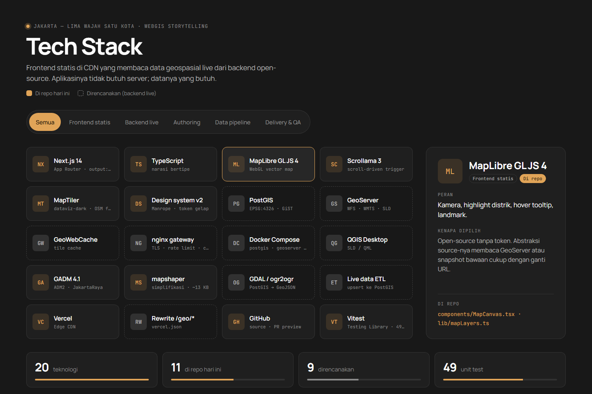

# Jakarta Scrollytelling WebGIS — Tech Stack

**Companion to:** [`architecture.md`](architecture.md) · **Interactive overview:** [`design/tech-stack.html`](design/tech-stack.html)

The stack follows one principle (architecture §2): **a static frontend on a CDN, reading live geodata from an open-source geospatial backend**. The app never needs a server; the data does. A GeoJSON snapshot exported from PostGIS at build time is bundled as the fallback.

**Status** — ✅ in this repo today · 🔜 live backend, specified in architecture §6 and not stood up yet.

---

## 1. Frontend (static)

- **Next.js** (14, App Router, `output: 'export'`) — static export to `out/`; no SSR or serverless, in POC and live mode alike. ✅ `app/`, `next.config.mjs`
- **TypeScript** — typed narrative and camera config; bad district ids or coordinates fail at build. ✅ `lib/`, `types/`
- **MapLibre GL JS** (4) — WebGL map: camera, district highlight, hover tooltip, landmarks; its `source` abstraction reads either GeoServer or the bundled snapshot. ✅ `components/MapCanvas.tsx`, `lib/mapLayers.ts`
- **Scrollama** (3) — fires a chapter change as each panel scrolls into view. ✅ `components/Scroller.tsx`
- **MapTiler** (`dataviz-dark` style) — vector basemap with a domain-restricted key; darkened OSM raster when no key is set. ✅ `lib/basemap.ts`

## 2. Live geospatial backend (🔜 architecture §6)

- **PostGIS** (PostgreSQL) — single source of truth for districts and landmarks; GiST indexes; EPSG:4326 storage. 🔜 read-only roles for GeoServer and CI
- **GeoServer** — serves PostGIS layers as **WFS** (GeoJSON) and **WMTS**, with SLD styling — the data API the static app calls from the browser. 🔜
- **GeoWebCache** — tile cache inside GeoServer; pre-renders heavy / slow-changing layers. 🔜
- **nginx gateway** — TLS, rate limiting, response cache; keeps GeoServer admin private, reached only through the Vercel `/geo/*` rewrite. 🔜
- **Docker Compose** — runs `postgis`, `geoserver` and the gateway reproducibly (managed alternative: RDS / Cloud SQL + a GeoServer container). 🔜

## 3. Authoring

- **QGIS Desktop** — edit geometry and attributes directly in PostGIS; spatial analysis; author styles (SLD/QML) and publish them to GeoServer. 🔜 used by analysts, never called by the app

## 4. Data pipeline

- **GADM 4.1** (ADM2) — boundaries of the five kota; today seeds the snapshot directly, live it seeds PostGIS once. ✅ `scripts/build-districts.mjs`
- **mapshaper** — simplifies boundary geometry (~13 KB output). ✅ district build
- **GDAL / `ogr2ogr`** — exports the GeoJSON snapshot from PostGIS before `next build`; also loads seed data into PostGIS. 🔜 CI step, architecture §6.6
- **Live data ETL** — upserts frequently-changing layers into PostGIS. 🔜 roadmap v3

## 5. Delivery and QA

- **Vercel** (Edge CDN) — hosts the static app and the bundled snapshot; Git integration builds every push; the single origin the browser talks to. ✅
- **Vercel rewrite** `/geo/*` — forwards live-data requests to the backend gateway so the browser stays on one origin (no CORS). 🔜 `vercel.json`
- **GitHub** — source; PR previews via Vercel. ✅
- **Vitest + Testing Library** (jsdom) — unit tests for the chapter/camera model, paint helpers and components (63 tests). ✅ `tests/`, `vitest.config.ts`

---

## Configuration switches

The frontend is the same build artifact in every mode; build-time environment variables pick the sources.

- **`NEXT_PUBLIC_MAPTILER_KEY`** — set → MapTiler vector basemap; empty → darkened OSM raster.
- **`NEXT_PUBLIC_GEO_LIVE`** 🔜 — set → layers read GeoServer WFS/WMTS at `/geo/*` (snapshot is the fallback); empty → snapshot only (today's POC).

## Why these, not the alternatives

The full decision record is architecture §11. In short: **MapLibre** over Mapbox/Leaflet (open, vector, no token); **PostGIS + GeoServer** over a serverless feature API (OGC standards, server-side spatial queries, tiling, live data); **QGIS** over ArcGIS Pro (free, native PostGIS editing and GeoServer publishing); **Next.js static export** over SSR (the story UI is identical for every visitor, so only the data tier needs servers).
